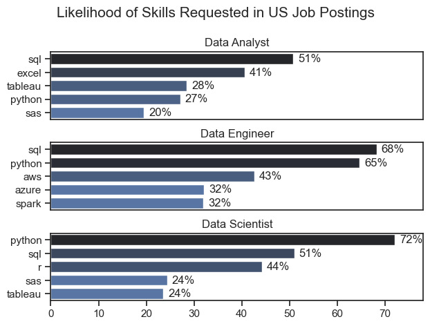
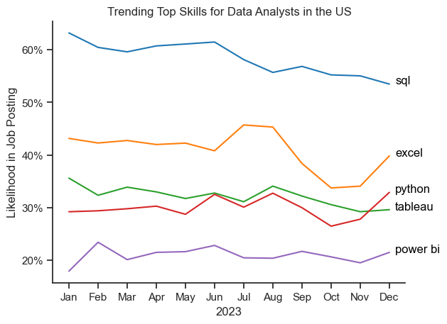
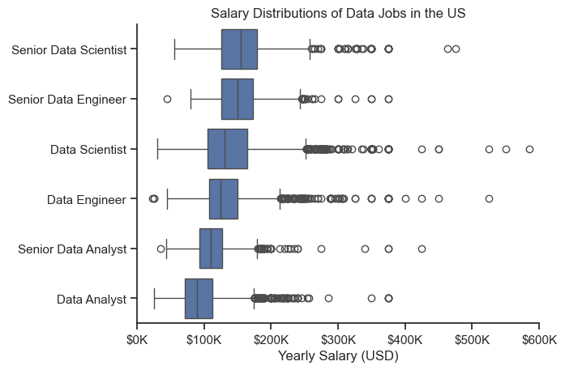
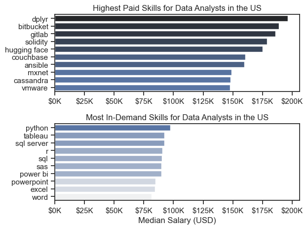
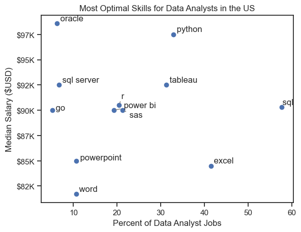
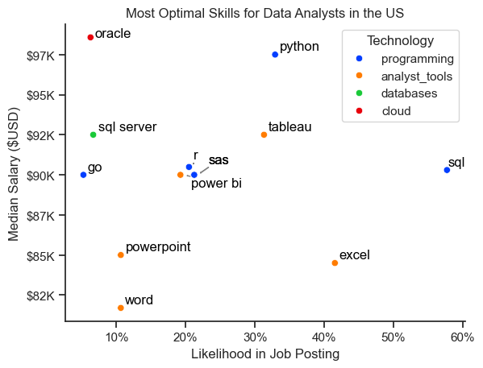

# Python Project: Exploring the Data Analyst Job Market

## 1. Project Overview

Understanding the job market is an important part of making informed career decisions, especially in the rapidly evolving data industry.

As a Data Analyst, I wanted to explore what employers are actually looking for when hiring data professionals. Rather than focusing only on job titles and salary expectations, I wanted to understand the relationship between technical skills, market demand and earning potential.

In this project, I analysed job postings from the US market to identify the most востребован skills, examine salary distributions and determine which technical skills offer a combination of strong market demand and competitive salaries.

The analysis was conducted using Python, with a focus on data cleaning, exploratory data analysis (EDA), aggregation and data visualisation.

**Data Source:** [Luke Barousse – Python for Data Analytics](https://lukebarousse.com/python)

The dataset provides job posting information, including job titles, salaries, locations and required technical skills. It serves as the foundation for my analysis and exploration of the data job market.

### Key Objectives

- Identify the most frequently requested skills across popular data-related job roles.
- Analyse changes in Data Analyst skill demand throughout 2023.
- Compare salary distributions across different data-related positions.
- Identify technical skills associated with both higher salaries and stronger market demand.

---

## 2. Business Questions

I structured this project around four key questions to understand the current landscape of data-related careers.

| No. | Business Question |
|---|---|
| 1 | What are the most in-demand skills for the top three most popular data roles? |
| 2 | How did the demand for Data Analyst skills change throughout 2023? |
| 3 | Which data-related roles and technical skills offer the highest salaries? |
| 4 | What are the most optimal skills for Data Analysts to develop based on salary and demand? |

These questions help connect the analysis to practical career decisions, particularly when prioritising technical skills for professional development.

---

## 3. Tools & Technologies

The following tools and Python libraries were used throughout the project.

| Tool / Technology | Purpose |
|---|---|
| Python | Data analysis and processing |
| Pandas | Data manipulation, cleaning and aggregation |
| Matplotlib | Data visualisation |
| Seaborn | Statistical visualisation and graphical analysis |
| Jupyter Notebook | Exploratory analysis and documentation |
| Visual Studio Code | Python development environment |
| Git & GitHub | Version control and project documentation |

---

## 4. Data Preparation & Cleaning

Before conducting the analysis, I performed initial data preparation to ensure the dataset was structured correctly and suitable for further investigation.

### Data Loading

I imported the required Python libraries and loaded the dataset using the Hugging Face Datasets library.

```python
import ast
import pandas as pd
import seaborn as sns
import matplotlib.pyplot as plt

from datasets import load_dataset

# Load dataset
dataset = load_dataset('lukebarousse/data_jobs')
df = dataset['train'].to_pandas()
```

### Data Cleaning

The initial preparation involved converting the job posting dates into a datetime format and transforming the skills column into a structured Python list.

```python
# Convert posting dates
df['job_posted_date'] = pd.to_datetime(
    df['job_posted_date']
)

# Convert job skills into Python lists
df['job_skills'] = df['job_skills'].apply(
    lambda x: ast.literal_eval(x)
    if pd.notna(x) else x
)
```

This allowed me to perform time-based analysis and examine individual skills more effectively.

### Filtering the Dataset

For consistency throughout the analysis, I focused on job postings from the United States.

```python
df_US = df[
    df['job_country'] == 'United States'
]
```

This filter provided a consistent geographical scope when comparing job demand and salary distributions.

---

## 5. Exploratory Data Analysis & Key Findings

### 5.1 Most In-Demand Skills Across the Top Three Data Roles

**Business Question:** What are the most in-demand skills for the top three most popular data roles?

I started by identifying the three most frequently advertised data-related job roles. I then examined the skills associated with each position to understand what employers prioritise when recruiting data professionals.

The objective was to identify common technical requirements while highlighting the differences in skill expectations across Data Analysts, Data Scientists and Data Engineers.

**Notebook:** [2_Skill_Demand.ipynb](2_Skill_Demand.ipynb)

**Visualisation:**



*Figure 1: Percentage of US job postings requesting the top five skills across three popular data roles.*

**Key Findings:**

- **SQL is a fundamental requirement:** More than half of the Data Analyst and Data Scientist job postings mention SQL, highlighting the importance of database querying and data extraction skills.
- **Python has strong cross-industry demand:** Python is highly requested across all three roles, particularly Data Scientists (72%) and Data Engineers (65%).
- **Different roles require different technical specialisations:** Data Engineers place greater emphasis on cloud platforms and data infrastructure technologies such as AWS, Azure and Spark.
- **Data Analysts require a broader combination of analytical tools:** Excel, SQL and Tableau remain important for data manipulation, reporting and visualisation.

**My Interpretation:**

The findings suggest that technical skills should be developed according to the career path being pursued. SQL and Python provide a strong foundation across multiple data professions, while specialised tools can help professionals develop expertise in their respective areas.

---

### 5.2 Data Analyst Skill Demand Trends Throughout 2023

**Business Question:** How did the demand for Data Analyst skills change throughout 2023?

For this analysis, I narrowed the dataset to Data Analyst positions and examined how frequently specific skills appeared in job postings throughout the year.

I grouped the postings by month and calculated the percentage of job advertisements mentioning each skill. This allowed me to compare skill demand over time rather than relying solely on overall demand figures.

**Notebook:** [3_Skills_Trend.ipynb](3_Skills_Trend.ipynb)

**Visualisation:**



*Figure 2: Monthly trends in the most requested Data Analyst skills in the US during 2023.*

**Key Findings:**

- **SQL maintained strong demand:** Despite a gradual decline during certain periods, SQL remained one of the most consistently requested skills throughout the year.
- **Excel gained momentum:** Demand for Excel increased noticeably around September and surpassed Python and Tableau towards the end of the year.
- **Python and Tableau remained relevant:** Both technologies maintained relatively stable demand, reinforcing their importance in data analysis and visualisation.
- **Power BI showed growth potential:** Although its overall demand was lower than some other tools, it experienced a slight upward trend towards the end of the year.

**My Interpretation:**

One interesting observation is that employers continue to value traditional analytical tools such as Excel and SQL, even as programming and business intelligence technologies become increasingly important.

For aspiring Data Analysts, this suggests that building strong fundamentals is just as important as learning newer technologies.

---

### 5.3 Salary Analysis: Data Roles and Technical Skills

**Business Question:** Which data-related roles and technical skills offer the highest salaries?

To understand salary differences across the data industry, I compared the average annual salary distributions of six popular data-related job titles.

I used box plots to examine salary ranges, median values and potential outliers. This provides a clearer picture of how compensation differs across roles and levels of specialisation.

**Notebook:** [4_Salary_Analysis.ipynb](4_Salary_Analysis.ipynb)

**Visualisation:**



*Figure 3: Annual salary distributions across six data-related job titles in the US.*

**Key Findings:**

- **Senior positions command higher salaries:** Senior Data Scientists and Senior Data Engineers generally have higher salary distributions compared with non-senior positions.
- **Salary variation differs by role:** Senior technical positions show a wider salary range and several high-end outliers.
- **Specialisation influences earning potential:** Roles requiring more advanced technical expertise tend to have higher salary potential.
- **Experience matters:** The difference between senior and non-senior positions highlights the potential financial benefits of developing technical expertise and gaining industry experience.

**My Interpretation:**

The salary distributions suggest that career progression is not simply about changing job titles. Developing specialised technical capabilities and gaining practical experience can contribute to higher earning potential.

However, salary outliers should be interpreted carefully, as they may reflect exceptional positions rather than typical compensation.

#### Highest-Paid vs Most In-Demand Skills for Data Analysts

After comparing salaries across job titles, I narrowed the analysis to Data Analyst positions.

I examined two dimensions:

1. The highest-paying technical skills based on median annual salary.
2. The most frequently requested skills based on the number of job postings.

Comparing these two measures helps identify the difference between skills that offer higher earning potential and those that are essential for securing employment.

**Visualisation:**



*Figure 4: Comparison of the highest-paying and most frequently requested Data Analyst skills in the US.*

**Key Findings:**

- **Specialised technologies are associated with higher salaries:** Skills such as dplyr, Bitbucket and GitLab appear among the higher-paying skills in this analysis.
- **Core analytical tools dominate job requirements:** Excel, PowerPoint and SQL are among the most frequently requested skills.
- **High demand does not always translate into higher salaries:** Some foundational skills are widely requested but are not necessarily associated with the highest median salaries.
- **Technical specialisation creates opportunities:** Developing expertise beyond basic reporting and data manipulation may help Data Analysts access more specialised opportunities.

**My Interpretation:**

There is a noticeable difference between the skills employers frequently request and the skills associated with higher salaries.

For someone building a career in data analytics, I believe the best approach is to establish a strong foundation in essential tools such as SQL and Excel before progressing towards more specialised technologies.

---

### 5.4 Identifying the Most Optimal Skills for Data Analysts

**Business Question:** What are the most optimal skills for Data Analysts to develop based on salary and demand?

For the final analysis, I combined skill demand and median salary to identify technologies that offer a balance between market relevance and earning potential.

Rather than evaluating skills based on salary alone, I wanted to understand which technologies are both frequently requested by employers and associated with competitive compensation.

I calculated the percentage of job postings mentioning each skill and compared it against the corresponding median annual salary.

**Notebook:** [5_Optimal_Skills.ipynb](5_Optimal_Skills.ipynb)

**Visualisation:**



*Figure 5: Relationship between skill demand and median salary for Data Analysts in the US.*

**Key Findings:**

- **Oracle stands out in salary potential:** Oracle has one of the highest median salaries in this analysis, at approximately $97K, despite appearing in fewer job postings.
- **SQL and Excel remain highly relevant:** Both skills are frequently requested by employers, making them important foundations for Data Analyst positions.
- **Python and Tableau offer an interesting balance:** Both technologies demonstrate competitive salary potential alongside meaningful demand.
- **Specialised database knowledge can be valuable:** SQL Server and Oracle highlight the importance of database technologies within the data analytics profession.

**My Interpretation:**

The analysis highlights an important distinction between learning a skill because it is popular and learning a skill because it can improve career opportunities.

For me, the most valuable skills are those that provide a combination of practical application, employer demand and long-term career potential.

#### Analysing Skills by Technology Category

To understand the results further, I categorised the technical skills into different technology groups and visualised their relationship with salary and demand.

This makes it easier to identify whether certain technology categories are more strongly associated with higher compensation.

**Visualisation:**



*Figure 6: Skill demand and median salary categorised by technology type.*

**Key Findings:**

- **Programming:** Programming-related skills tend to appear towards the higher end of the salary distribution, demonstrating the value of programming capabilities in analytical roles.
- **Databases:** Technologies such as Oracle and SQL Server show competitive salary potential, reinforcing the importance of database management and querying.
- **Analyst tools:** Tableau and Power BI demonstrate the continued relevance of business intelligence and data visualisation technologies.

**My Interpretation:**

The results suggest that Data Analysts can benefit from developing skills across multiple technology categories.

A combination of programming, database management and visualisation capabilities can provide a stronger technical foundation than focusing on a single tool.

---

## 6. What I Learned From This Project

This project gave me an opportunity to apply Python to a practical analytical problem while developing a better understanding of the data job market.

Beyond learning Python syntax, I gained experience in approaching a dataset from an analytical perspective.

Some of my key takeaways include:

**1. Data Cleaning and Preparation**

I developed a better understanding of how to prepare raw datasets before performing analysis. Working with datetime conversions, missing values and nested skill information helped me understand the importance of data quality.

**2. Exploratory Data Analysis (EDA)**

I used Pandas to filter, group and aggregate data to identify patterns and trends. This strengthened my ability to investigate datasets and extract meaningful information.

**3. Data Visualisation**

I worked with Matplotlib and Seaborn to create different visualisations, including bar charts, line charts, box plots and scatter plots. I learned how to select appropriate visualisations depending on the analytical question.

**4. Analytical Thinking**

I learned to approach data analysis by defining specific questions before exploring the dataset. This helped me focus on findings that could support practical decisions rather than simply generating charts.

**5. Interpreting Data for Decision-Making**

One of my biggest takeaways was understanding that data analysis is not just about presenting numbers. It is about identifying patterns, explaining what they mean and communicating findings in a way that supports better decisions.

---

## 7. Challenges Faced

Throughout the project, I encountered several challenges that helped improve my problem-solving and analytical skills.

- **Handling inconsistent data:** Preparing the skills column required converting string-based lists into structured Python objects before performing further analysis.
- **Working with complex datasets:** Filtering and aggregating job postings across different roles, locations and time periods required careful data manipulation.
- **Choosing the right visualisation:** Selecting suitable chart types was important to ensure that the findings were easy to interpret.
- **Interpreting salary data:** Salary distributions contain variations and outliers, making it important to use median values and understand the limitations of the dataset.
- **Connecting findings to practical insights:** Translating statistical results into meaningful observations required more than simply describing what appeared in each chart.

These challenges helped me develop a more structured approach to analysing data and communicating results.

---

## 8. Conclusion

This project allowed me to explore the US data job market from a Data Analyst's perspective, using Python to investigate skill demand, salary distributions and emerging patterns across different data-related roles.

A few important conclusions stood out from my analysis:

- SQL and Excel remain essential skills for Data Analysts.
- Python and data visualisation tools provide additional technical capabilities that are relevant across the data industry.
- Specialised database and programming skills are associated with competitive salary opportunities.
- Understanding both skill demand and salary trends can help professionals make more informed decisions about their technical development.

**My biggest takeaway:** Becoming a competitive Data Analyst is not about learning every available technology. It is about understanding which skills are relevant, developing them through practical application and continuously adapting to industry requirements.

I intend to build on this project by exploring more advanced analytical techniques, automation and real-world datasets as I continue developing my skills in data analytics.

---

## 9. Acknowledgement

This project was developed as part of my learning journey in Python for Data Analytics, following the educational materials and guidance provided by **Luke Barousse**.

The original dataset and learning resources provided the foundation for this project. The analysis, visualisations and interpretations documented here reflect my own implementation and exploration of the dataset.

**Data Source:** [Luke Barousse – Python for Data Analytics](https://lukebarousse.com/python)

**Project Repository:** [Python_Data_Project – GitHub](https://github.com/Haridas2000/Python_Data_Project)


